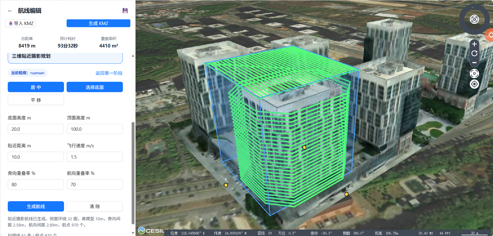
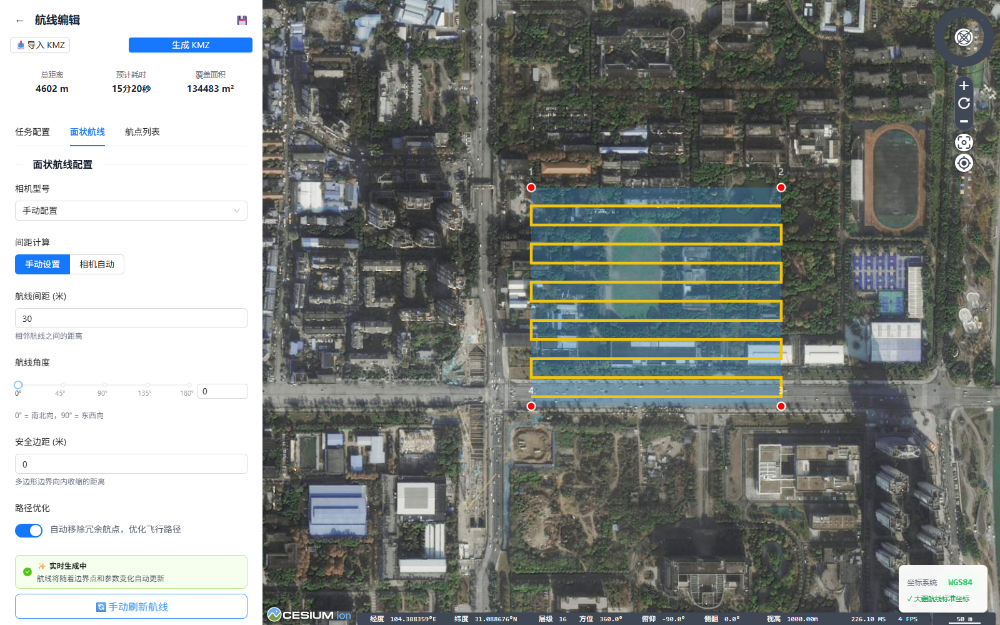
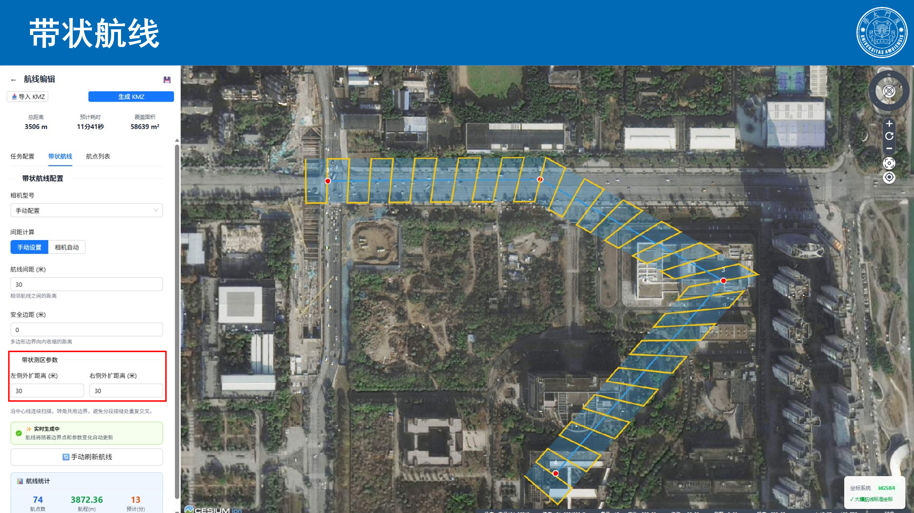
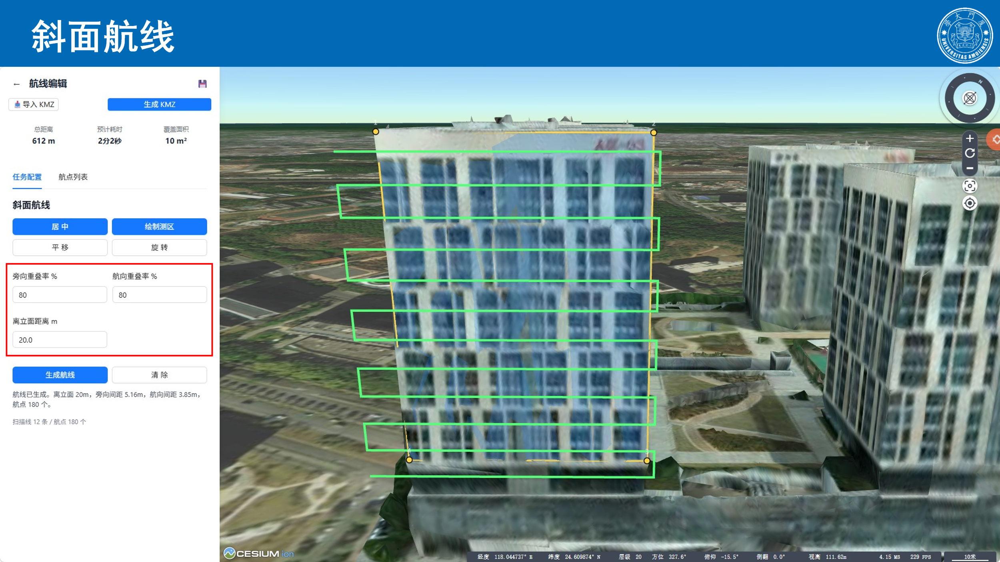
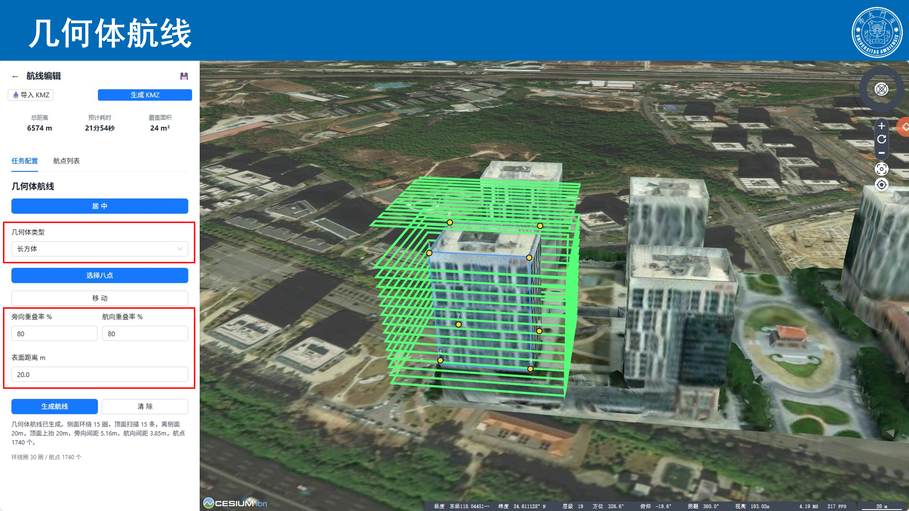
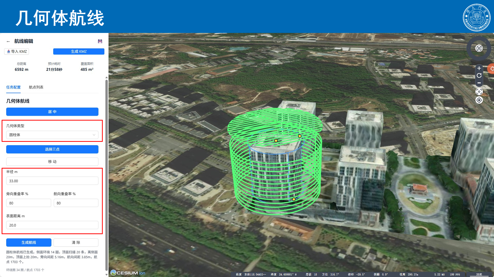
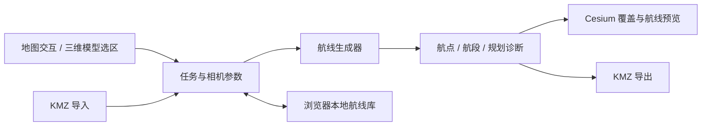

# UAV Mission Planning · 无人机多类型航线规划

[English](README.en.md) · [使用说明](docs/USAGE.md) · [系统架构](docs/ARCHITECTURE.md) · [验证记录](docs/VALIDATION.md) · [下载资料与模型](https://github.com/xmuzr/uav-mission-planning/releases/tag/v0.1.0)

基于 Vue 3、CesiumJS 与 Three.js 的浏览器端无人机航线规划工具，面向道路、桥梁、建筑立面及规则构筑物的巡检与摄影测量任务。通过地图交互或三维模型选区，配置相机、重叠率、拍摄距离等参数，生成航点并导出 DJI WPML 格式的 KMZ 文件。

当前交付实现八类航线配置、二维/三维规划、摄影覆盖预览和本地航线管理。



## 功能

| 类型 | 规划方式 | 典型用途 |
| --- | --- | --- |
| 航点航线 | 交互添加与编辑航点 | 指定巡检位置与拍摄动作 |
| 巡逻航线 | 区域扫描与航点组织 | 区域巡查 |
| 面状航线 | 多边形裁剪与往复式扫描 | 区域摄影测量 |
| 倾斜航线 | 多方向扫描与云台角配置 | 多视角影像采集 |
| 带状航线 | 沿中心线生成共享截面与扫描行 | 道路、河道等带状目标 |
| 斜面航线 | 平面局部坐标与模型选区扫描 | 建筑立面和斜面目标 |
| 几何体航线 | 长方体表面扫描、圆柱分层环绕及顶面扫描 | 规则构筑物 |
| 贴近摄影航线 | 模型表面射线采样、拍摄位筛选及连续航段连接 | 模型辅助的精细化采集 |

- 使用 Cesium 三维地球和模型展示航点、扫描线、相机覆盖及规划诊断。
- 配置相机参数、拍摄距离、重叠率、云台角及部分飞行动作。
- 导入、导出 KMZ；精细贴近摄影区分拍摄点与不拍摄的过渡点。
- 航线库保存到浏览器 `localStorage`，无需数据库服务。
- 提供 26 项现有自动化测试，覆盖贴近摄影、几何体覆盖与 KMZ 导出等逻辑。

## 界面与规划示例

以下图片来自本项目已有技术文档和实验报告，展示界面规划结果。

| 面状扫描 | 带状规划 |
| --- | --- |
|  |  |

| 斜面扫描 | 长方体表面扫描 |
| --- | --- |
|  |  |

| 圆柱体环绕 | 贴近摄影 |
| --- | --- |
|  |  |

## 系统流程



## 快速开始

建议使用 Node.js 22.21.1 或兼容的 Node.js 22/24 版本，以及支持 WebGL 的 Chrome / Edge。

```bash
git clone https://github.com/xmuzr/uav-mission-planning.git
cd uav-mission-planning
npm ci
npm run dev -- --host 127.0.0.1
```

打开终端显示的本地地址，通常为 `http://127.0.0.1:5173/`。地图影像依赖高德在线瓦片，需要网络连接。

### 加载示例三维模型

二维航线编辑无需示例模型。默认的斜面、几何体和精细贴近摄影视图使用 `ruansan` 三维瓦片：

1. 从 [v0.1.0 Release](https://github.com/xmuzr/uav-mission-planning/releases/tag/v0.1.0) 下载 `ruansan-model.zip`。
2. 解压到 `public/models/`，确保存在 `public/models/ruansan/tileset.json`。
3. 开发模式刷新页面；生产模式需在解压后执行 `npm run build`。

Windows PowerShell 可在仓库根目录执行：

```powershell
Invoke-WebRequest -Uri 'https://github.com/xmuzr/uav-mission-planning/releases/download/v0.1.0/ruansan-model.zip' -OutFile 'ruansan-model.zip'
Expand-Archive -LiteralPath 'ruansan-model.zip' -DestinationPath 'public/models' -Force
```

也可以在支持模型地址配置的视图中使用自己的 `tileset.json`；远程资源需允许跨域访问。模型坐标系与高程含义见[使用说明](docs/USAGE.md)。

### 构建、启动与测试

```bash
npm test
npm run build
npm start
```

`npm start` 使用 `server.cjs` 提供 `dist/` 静态服务，监听 `127.0.0.1`，默认端口为 5173，端口占用时依次尝试至 5193。源码修改后需重新构建。不要直接双击 `dist/index.html`。

## 目录

```text
uav-mission-planning/
├── src/
│   ├── components/WaypointGenerator/  # 航线库、参数面板、地图与三维规划视图
│   └── utils/                        # 航线算法、覆盖计算、坐标转换、KMZ
├── tests/                            # Node.js 原生测试
├── public/models/                    # 示例模型解压位置
├── docs/                             # 架构、操作说明、验证记录和截图
├── .github/workflows/check.yml       # 安装依赖、测试与构建
├── package-lock.json                 # npm 依赖锁定
├── server.cjs                        # 本地生产构建静态服务
└── LICENSE                           # 沿用现有 GPL-3.0 许可证
```

## 技术栈

| 组件 | 职责 |
| --- | --- |
| Vue 3 / Ant Design Vue | 任务编辑与参数交互 |
| CesiumJS / Vue Cesium | 地理坐标、三维模型与覆盖预览 |
| Three.js | 部分三维模型视图与计算 |
| JSZip | KMZ 文件打包与读取 |
| Vite / UnoCSS | 构建与样式 |
| Node.js 原生 HTTP / Test Runner | 本地静态服务与自动化测试 |

具体版本以 `package-lock.json` 为准。

## 文档与交付资料

- [使用说明](docs/USAGE.md)：任务创建、模型安装、航线保存和导出。
- [系统架构](docs/ARCHITECTURE.md)：源码入口、数据流与坐标处理。
- [验证记录](docs/VALIDATION.md)：测试范围、构建结果和验证边界。
- [更新记录](CHANGELOG.md)：本次发布整理内容。
- [Release](https://github.com/xmuzr/uav-mission-planning/releases/tag/v0.1.0)：三维模型、演示 PPTX 及 SHA-256 校验清单。Word 文档保留在本地。


